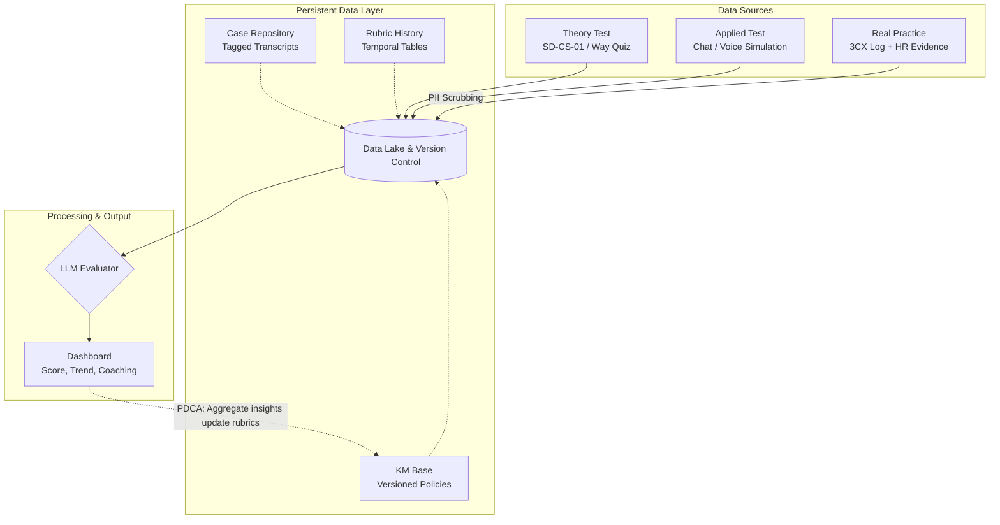

# Executive Proposal: Agentic Coaching & Evaluation Platform (ACEP)

## 1. Architectural Wireframe

The following logical architecture expands the initial proof-of-concept into a scalable, enterprise-grade coaching platform supporting continuous improvement (PDCA).

## 2. Dashboard UI Wireframe Concept

| **Executive Overview (Top Band)** |
| :--- |
| **Global Quality Score:** 85% (+2%) \| **Total Evaluations:** 1,204 \| **Active Rubric:** v2.4 |

| **Evaluation Source Distribution** | **Agent Performance Trends** |
| :--- | :--- |
| [Pie Chart]   - Theory (20%)   - Applied Sim (50%)   - Real 3CX (30%) | [Line Graph]   Historical performance mapped against Rubric version changes. |

| **Recent Coaching Cases (Case Repository)** |
| :--- |
| **ID** \| **Source** \| **Agent** \| **Score** \| **Tag** \| **Action**   102 \| 3CX Log \| A. Smith \| 72/100 \| Escalation, Empathy \| [View AI Rationale]   103 \| Simulator \| B. Jones \| 95/100 \| Product Knowledge \| [View Transcript] |

## 3. Addressing Technical Constraints

### A. Real Practice (3CX) Integration & Security
Processing real customer interactions introduces severe data privacy and compliance risks (PDPA/GDPR/PCI).
*   **Constraint:** Raw 3CX logs cannot be fed directly to an LLM evaluator.
*   **Solution (Architecture):** Implement a Data Sanitization Middleware (e.g., using NLP NER models or regex) to redact Personally Identifiable Information (PII) before the transcript enters the Persistent Data Layer.
*   **Access Control:** Strict Role-Based Access Control (RBAC) must be enforced. Evaluators and AI models operate only on masked data; original audio/logs remain secured on-premise or within isolated storage.

### B. Persistent Data Layer Design
Transitioning from one-shot processing to a continuous learning loop requires a structured, multi-model data architecture.
*   **Schema Design:**
    *   **Rubric Versioning:** Use temporal tables in a relational database (PostgreSQL). Every evaluation must lock onto a specific `rubric_version_id` to ensure historical scores remain valid when the baseline criteria change.
    *   **Case Repository:** Utilize a Document Database (MongoDB or PostgreSQL JSONB) to store transcripts. Append metadata tags (`test_type`, `competency_failed`, `agent_id`) to enable advanced filtering and aggregate trend analysis.
    *   **KM Base:** Implement a Git-like version control system for policy documents. When the LLM evaluates a case, it retrieves the exact KM document version that was active at the time of the test.
